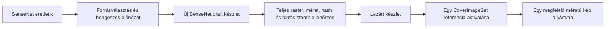

# Statikus listaborítók és médiaképméretek

Ág: `feature/sensenet-image-variants`. Ez a leírás az [M0 tárolási alap](image-variants-m0-verification.md) alkalmazásba kötését követi. Az interaktív, elforgatott kártyanézet későbbi feladat.

## Helyi használat

A repó gyökeréből:

```powershell
& deployment/scripts/m0-runtime.ps1 start
node scripts/m0-local-api.cjs
npm run dev:m0
```

Alkalmazás: **https://localhost:8080**. A fejlesztői sávban `m0-local`, a repositorynál `https://localhost:41016` legyen. A korábban létrehozott helyi szerkesztő belépési adatai az ignored `deployment/.local/accounts.json` fájlban vannak. Új account, új kulcs és éles bejelentkezés nem kell.

Timeline: nyisd meg, válaszd az **Edit Timeline** műveletet, majd a **List cover** panelt. Jelölj ki legfeljebb négy képet, rendezd a nyilakkal, vagy használd a **Random selection** gombot. A választó az első legfeljebb ötven elérhető, egyedi médiaképből dolgozik; ezt a felület jelzi. A **Generate preview** előnézetet készít. A **Publish** tölti fel és aktiválja a teljes készletet. A kiválasztás és sorrend elmentődik, látogatói megnyitáskor nincs új sorsolás.

Média: a részletoldal **Image sizes** paneljében **Prepare sizes**, majd **Publish**. A kisebb példányok a Media Library és a timeline-bejegyzések képeihez is használódnak. A **Use original presentation** leválasztja a generált készletet; az eredeti fájlt nem írja felül. A **Delete unused copies** külön megerősítéssel, csak inaktív generált készleteket töröl. Az aktív képkészlet és az eredetik megmaradnak.

Generáláshoz SenseNetben tárolt, PNG/JPEG/WebP eredeti kell. Ha még csak link van, az **Upload original** fájlválasztóval feltölthető az eredeti; a kijelölt fájlt azonnal, átméretezés és újrakódolás nélkül menti. Ez a meglévő eredetiborító-írási folyamatot használja. A timeline választója csak ilyen tárolt eredetiket kínál fel. Külső linkekből nem indul automatikus letöltés vagy tömeges tartalomírás.

A régebbi, `application/octet-stream` MIME-mal tárolt eredetik is használhatók, ha a tényleges fájl PNG/JPEG/WebP. Az API csak az általános MIME esetén ismeri fel a támogatott byte-szignatúrát; az ismert, de hibás MIME és a HTML/SVG/PDF nem lesz elfogadva. A generátor méretkorlátja és teljes böngészős dekódolása megmarad. Ez olvasáskori felismerés: az eredeti byte-ok, fájlnév és SenseNet-metaadatok nem módosulnak.

Ha a forrás képe megváltozik, a generált kép elavult lesz: új előnézetet és publikálást kérünk. Egy cím vagy jegyzet átírása önmagában nem teszi elavulttá. A forrás/owner olvasási jogának elvesztése elrejti a generált képet; nincs csendes visszaesés régi byte-okra.

## Mi hol van?

```text
/Root/Content/timelines/
  Timelines/<timeline>         CoverImageSet -> aktív készlet
  MediaLibrary/<media>         CoverImageBin / CoverImageUrl: eredeti
                              CoverImageSet -> aktív méretkészlet
  ImageAssets/<ownerId>/<generationUUID>/
    ImageVariantSet           owner, források, recept, forrás-stampek, manifest
      w400                    ImageVariant.Binary (például image/webp)
      w800
      w1200
```

A média méretei tipikusan `w160`, `w320`, `w640`. Nem készül felskálázott hamis részletesség: kisebb forrásnál kevesebb méret lesz. A fájlnevek biztonsági okból kiterjesztés nélküliek; a valódi formátumot a Binary MIME és a manifest tartalmazza.

Minden új generált fájl közvetlenül SenseNetbe kerül. A böngésző memóriájában készül az előnézet; a Netlify app azonosítókat és nyugtákat tart a meglévő koordinációs/journal-tárolóban. Az új képfolyamat nem ment képbyte-okat Blobsba. A korábbi eredetifeltöltés és ZIP-átvitel meglévő, ideiglenes transfer-mechanikája ettől külön, változatlan.



Hiba esetén a korábbi aktív készlet megmarad. Bizonytalan válasznál a **Retry publication** ugyanazt a mentési kísérletet és kéréskulcsokat folytatja. Nem készít új generációt pusztán egy elveszett HTTP-válasz miatt. Az újrapróbálási állapot a megnyitott szerkesztő munkamenetéhez kötött; újratöltés után a tényleges repositoryállapotot kell ellenőrizni, az app meglévő journal/recovery útja megmarad.

A kliens a mért helyszélesség × legfeljebb kétszeres DPR alapján egy méretet választ. A fetch csak a viewport közelében indul, egyszerre legfeljebb két képletöltéssel. Növekvő helyhez szükség esetén nagyobb változat érkezik; szűkülés nem tölt le új kisebb fájlt. A generált timeline-kártya nem kér entry-poolt vagy négy eredeti posztert.

## Ellenőrzés

```powershell
node --test tests/image-client.test.mjs tests/lazy-image.test.mjs tests/image-publication-client.test.mjs
node tests/image-client-browser.mjs
node scripts/m0-image-app-smoke.cjs
node scripts/m0-image-ui-smoke.cjs
```

A natív és UI-próbák saját helyi fixture-ökkel dolgoznak, alapból kitakarítanak. A UI-smoke `--keep-demo` kapcsolója külön, azonosítható helyi mintát hagyhat; a jelentés az ignored `deployment/.local` alatt található. Production célra ezek a scriptek nem használhatók.

A végleges bővítménnyel **191/191 natív ellenőrzés sikeres**: alkalmazási képfolyamat 16, képvédelem 42, meglévő backend 13, referencia-adatvédelem 74 és timeline-adatvédelem 46, utóbbi 1369 versenymintával. A tesztelt fő DLL SHA-256: `7656872462ebea34ef1b88863efba893174ce186e805fbbe36a8cf7ff24a3a2d`. Mindegyik saját fixture-t takarított; a folytatandó UI-fixture mellett a natív kör 3025 → 3025 rekordot hagyott.

A teljes JavaScript unit/contract kör 249/249, a metadata/native-availability/receipt parity kör 58/58 ellenőrzése sikeres. Lint, TypeScript és production build sikeres; a meglévő nagy főcsomag figyelmeztetése megmarad. A képszerkesztő/generátor külön, csak szerkesztéskor betöltött csomag. A valódi Chromium Canvas-próba a négy kompozíció WebP-kimeneteit és a PNG-fallbacket is dekódolta; ez külön ellenőrzés a szerkesztői folyamat mellett.

A valódi szerkesztői/Visitor UI-jelentés **17 sikeres ellenőrzést** tartalmaz: 14 a végső folytatásban futott, az 1–3 poszteres publikálás három korábbi bizonyítékát az érintetlen eredeti jelentésből, `carriedFrom` jelöléssel vette át. Az eredetik hash-eit a folytatás előtt ismét ellenőriztük; a kontrollált elveszett böngészőválasz bizonyítéka szintén külön megjelölt előzmény. Négyposteres publikálás, sorrend/Random/visszanyitás, inaktív készletek törlése, médiaméretek, eredetifeltöltés, entry-választó, rollback/újrapublikálás és jogosultság-visszavonás sikeres. Böngészőhiba: 0; saját fixture-ök kitakarítva.

Konkrét Visitor-minta: 384 CSS-pixeles kártya, DPR2 → egy `w800`, **0 eredeti kép és 0 entry-pool kérés**. Viewporton kívül 0 képbyte-fetchet indított. Médiakártya `w320`, részletoldal `w640`; a 60×90-es entry-előnézet `w160` fájlt kért. A 390 px széles mobilnézetben a 334 px-es képhelyen a kompozíció `contain` elrendezésben maradt. Változatlan generáció fókuszfrissítése 0 képbyte-ot töltött; visszavont source Open után a már betöltött kép is eltűnt. Az új eredetifeltöltés a 700×1000-es PNG teljes SHA-ját és dimenzióit megőrizte.

Helyi bizonyítékok: `deployment/.local/image-ui-smoke/0fede8c6-f01f-4d82-8a56-76efd3d7ee71/report.json` és ennek `continuations/c8ae5a9a-dafc-4638-8206-d7888bb0bfa1/report.json` folytatása. Ezek szintetikus tesztposzterekkel készült, helyi funkcionális eredmények; production minőség-/sávszélességmérést nem helyettesítenek.

A tesztadatok takarítása után az önálló rekorddarabszám-ellenőrzés ismét **2999**. Külön, csak olvasó valódi poszteres próba is sikeres a visszaállított [Conan timeline-on](https://localhost:8080/timelines/Conan%20the%20Barbarian): három régi, általános MIME-os JPEG-ből a tényleges szerkesztő 400×200 / 16,4 KB, 800×400 / 45,8 KB és 1200×600 / 82,4 KB WebP-előnézetet készített. A timeline és mindhárom eredeti verziója, dátuma, MIME-ja és SHA-ja változatlan; publikálás nem történt ezen a meglévő timeline-on. A folytatás mappájában `real-conan-preview.json` és `real-conan-preview.png` rögzíti ezt.

Az érvényesítés teljes rasterdekódolást végez a [MIT licencű SkiaSharp](https://github.com/mono/SkiaSharp) segítségével; csonka vagy több képkockás output nem publikálható. A saját 4.154-es managed/native dekóder privát AssemblyLoadContextben és read-only alkönyvtárban fut. A host meglévő 3.116-os managed függőségét nem cseréli le; ezt futó hoston is ellenőriztük. A PNG ezenfelül szigorú CRC-, raster- és chunkellenőrzésen megy át. A böngészős PNG-fallback csak a saját Canvas-kimenet metaadatchunkjait normalizálja, a forrást nem.

A natív CAS pontos provider-timestampet használ; a teljes alkalmazási snapshot hashébe ez is bekerül. A `utc:` prefixű dátumparaméter a SenseNet JSON.NET stringparaméter-kötésének törtmásodperc-vesztését kerüli meg. Nincs időtűrés vagy órán alapuló íróátvétel. A kihagyott vagy régi forrás-stamp nem aktiválható.

## Mért írási költség és hibából folytatás

A valódi UI-próba feltárta a telepített Netlify Dev 30 másodperces szinkron korlátját. Az alkalmazás öt ismételt set/forrás-ellenőrzési körét invokáción belüli, változatlan kötésre korlátozott újrahasználat és szűk mezőprojekció váltotta fel. A konkrét Save/AddNew preflight, a natív friss ellenőrzések és a végső bájt-/SHA-visszaolvasás megmaradtak.

A natív mérés egy négyposteres feltöltésben 212 `AssertOpen` hívást és 1388 ismételt dinamikusadat-olvasást talált. Csak az autentikált `ImageVariant.SaveAsync` zárolt `POST Upload` szakaszában használunk legfeljebb 32 bejegyzéses adatmemót. Minden keresés friss node-fejlécet olvas; a kulcs ID, verzió, timestamp és típus. Az aktuális jogosultság, verzióállapot, szöveg, binary-metaadat és forrás-stamp nincs ebben cache-elve. Mindkét tényleges írási guard teljesen friss adatot olvas. A memo a mentés végén törlődik; GET, seal, aktiválás és törlés nem használja.

Azonos ownerrel, négy forrással és kimeneti byte-okkal mért helyi összehasonlítás:

| Mérés | Előtte | Utána |
| --- | ---: | ---: |
| Natív feltöltés | 23,936 s | 8,359 s |
| Dinamikusadat-olvasás | 1388 | 256 |
| Friss node-fejléc | 1388 | 1388 |
| Friss verziólekérés | 1141 | 1141 |
| Jogosultságvizsgálat | 1600 | 1600 |
| Friss binary-metaadat | 376 | 376 |
| Forrásfrissesség-vizsgálat | 94 | 94 |
| Tényleges írási guard / rasterellenőrzés | 2 / 2 | 2 / 2 |

Ez kis, szintetikus helyi minta, nem production P95 vagy látogatói oldalbetöltés-mérés. A külön metadata- és binary-GET mérésben nem volt memo-találat: a friss olvasási kapu változatlan.

A valódi Conan-JPEG-ek publikálási próbája külön lezárási költséget is feltárt. A natív seal PATCH alapértelmezett teljes válasza olyan mezőket is szerializált, amelyeket a kliens nem használ. A szabványos `$select=Id&metadata=no` válaszprojekcióval ugyanazon owner/források/kimeneti byte-ok mellett a natív PATCH **19,119 → 9,777 s**, a belső seal-folyamat (előellenőrzés + írás + visszaolvasás) **21,335 → 11,561 s** lett. Ez utóbbi nem az egész gateway-HTTP-kérés ideje. Dinamikusadat-olvasás 1429 → 569; mindkét írási guard, mind a hat teljes rasterellenőrzés és mind a 14 forrásfrissesség-ellenőrzés megmaradt. A visszaolvasás továbbra is a mentett manifestet egyezteti. Új natív seal-cache nem készült; a bővítmény/DLL változatlan. Két saját diagnosztikai generációt igazoltan töröltünk, a meglévő set és az eredetik változatlanok. Ez is egyetlen helyi mintapár, nem P95-garancia.

Az új képírási kérések 25 másodperces kontrollált határidőt használnak. A dispatch előtti biztos hiba lezárható; a natív commit utáni bizonytalan kimenet függő bizonylat marad. Ugyanaz a kulcs csak visszaolvassa az eredményt, nem küldi újra a feltöltést. Ezt valódi, időkorlátot elérő UI-kéréseknél is igazoltuk: az azonos fájl/SHA visszaolvasása rendezte a bizonylatot, nulla adattári írással.

Operátori út: `POST /api/v1/images/recovery`, az eredeti `Idempotency-Key` fejléccel és `{operationId}` törzzsel, az eredeti backendidentitás munkamenetében. Ez csak visszaolvas. Ténylegesen leállt, még foglalt kérés feloldásához az operátornak külön meg kell erősítenie a pontos `stoppedRequestId`-t és `confirmStopped: true`-t; ezt a kliens nem küldi automatikusan timeout vagy eltelt idő alapján. Idegen művelet, kulcs, identitás vagy binding nem oldhat fel írót. A recovery nem ismétel natív írást.

## Élesítési sorrend és jelenlegi kapu

Ez nem kizárólag frontend-változás. **A PR merge-je és a Netlify build önmagában nem telepíti a szükséges SenseNet-funkciókat.** A kliens a natív `ImageAssetCapabilities` protokoll alapján engedi a publikálást; hiányzó támogatásnál a régi tartalom továbbra is használható, az új képeszköz nem aktiválódik.

1. A tényleges éles host üzemeltetőjével ellenőrizni kell a saját content handlerek, scope observer, natív műveletek és dekóder telepíthetőségét. A helyi Docker-proof ezt a SaaS hostra nem bizonyítja. Az éles handler-integrációnak meg kell őriznie az ottani jogosultsági modellt; a teljes M0 tesztaccount/provision-konfiguráció nem másolható élesre.
2. Mentés, az éles SenseNet-verzióhoz fordított és ellenőrzött extension, majd az opcionális mezők/típusok és az assetág szűk provisioningje. Ez külön, Joe által engedélyezett üzemeltetési művelet. Az alkalmazás oldalbetöltéskor nem provisionál.
3. Először egy privát próbatimeline és a kapcsolódó médiák: előnézet, publikálás, csere, forrásmódosítás, jogvisszavonás, eredeti hash-megőrzés és takarítás. Utána valódi Visitor-próba és éles posteres méret-/minőségmérés.
4. Az ellenőrzött frontend kiadása és egy kis nyilvános tartalmi kör feldolgozása. Az összes korábbi tartalom nem generálódik újra automatikusan, és látogatói kérés nem indít írást.
5. Visszaállításkor referencia-váltás az eredeti megjelenésre; az eredeti képek végig rendelkezésre állnak. Inaktív generált fájlok csak külön takarítással törlődnek.

2026-11-05-én a productionre küldött névtelen, csak olvasó capability-próba HTTP500-at adott, az új protokoll nem volt igazolható. Ez nem bizonyítja, hogy a hostra nem telepíthető extension; azt jelenti, hogy a szükséges támogatás jelenleg nem tekinthető elérhetőnek. Production írás nem történt. A [SenseNet saját leírása](https://docs.sensenet.com/tutorials/getting-started/getting-started-custom-backend/) egyénileg üzemeltetett repository webalkalmazásnál írja le a backend testreszabását; ebből nem következik a használt cloud csomag telepítési jogosultsága.

A zárolás egy repository processre bizonyított. Többhostos éles környezethez külön konkurencia-elfogadás szükséges. Az alkalmazás jelenlegi exportja az eredetikre épül; a generált készletek átvitele/automatikus tömeges regenerálása külön migrációs lépés. Az eredeti képeket nem szabad helyettesíteni a kis méretekkel egy export vagy takarítás során.
