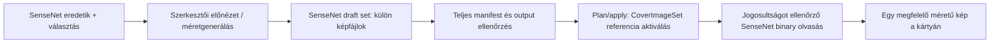

# Generált timeline-borítók és képváltozatok — megvalósítási javaslat

Dátum: 2026-11-02. Státusz: **terv, részletes megvalósítás előtt review-zandó**.
Ág: `feature/timeline-cover-variants-plan`; alap: `develop` / `8813d6fa`.
Az alap tartalmazza a merged PR #60-at (`7be70695`) és az utána mergelt dependency frissítéseket.

Megvalósítási követés, 2026-11-03: az első helyi backend-rész a `feature/sensenet-image-variants` ágban készül; pontos scope és ellenőrzés: [SenseNet képváltozatok M0](image-variants-m0-verification.md). A részletes terv alábbi későbbi app/UI fázisai ettől még nem készültek el.

**Joe tárolási döntése:** az eredetik, a generált timeline-borítók és valamennyi képméret a SenseNetben, a többi tartalom mellett maradjon. Netlify Blobs képtár nem készül. Ez felülírja a terv első változatának Blobs-ajánlását; az app meglévő journal/koordinációs állapotának tárolását nem változtatja meg.

## 1. Cél és javasolt sorrend

A timeline-listán egy kártyához egyetlen előre elkészített, megfelelő méretű képet töltsünk le. A médiaképekből is a felhasználási helyhez illő méret érkezzen. A már javított, folyamatos fejléc/szűrő/kereső betöltési viselkedése maradjon meg.

Fokozatos megvalósítást javaslok:

1. Közös képváltozat-tárolási és biztonságos kiszolgálási alap, egy timeline-on bizonyítva.
2. Statikus timeline-borító a mai, legfeljebb négy poszteres kompozíció stílusában; szerkesztői választással vagy véletlen összeállítással.
3. Ugyanennek a méretválasztásnak a bekötése a Media Library, timeline-bejegyzések és média-részletoldal képeihez.
4. Meglévő tartalom fokozatos feldolgozása, állapotjelzés és korlátozott takarítás.

Az első statikus kompozíció a javaslatom Joe „haladjunk fokozatosan?” kérdésére; a pontos vizuális sablon még előnézettel jóváhagyandó. Az elforgatott, egymást fedő kártyák és az egérrel pörgethető interaktív nézet későbbi feladat. A mostani adatmodell ne tegye ezeket szükségtelenné az eredeti képek összelapításával.

Az eredeti tervezési ágban dokumentáció készült. A követő M0 megvalósítás csak az izolált helyi környezetet módosítja; éles séma, tartalom, ACL, kulcs és hosting-konfiguráció módosítása nem része ennek a körnek.

## 2. Ellenőrzött kiindulás

| Jelenlegi szerződés | Következmény |
| --- | --- |
| A `Timeline` és `MediaItem` sémában is van `CoverImageBin` és `CoverImageUrl`. A `BookMediaItem` a médiamodell része. | Az eredeti forrás már tárolható a SenseNetben; nem kell második médiakatalógus. |
| A natív cover upload `Timeline`, `MediaItem`, `BookMediaItem` célra működik, de mindig a `CoverImageBin` mezőt írja. | Méretváltozatokat nem tölthetünk fel ezzel a metódussal az eredeti felülírása nélkül. |
| PNG/JPEG/WebP, legfeljebb 10 MiB; jelenleg MIME/szignatúra ellenőrzés van. | A változatokhoz külön, dimenziót és tényleges dekódolhatóságot is ellenőrző út kell. |
| Feltöltés és apply pontos revisionnel, scoped jogosultsággal, közös writerrel és journal/recovery-védelemmel történik. | Az új publikálás is ezen az alkalmazási határon menjen át. |
| A timeline-lista URL-es egyedi borítót vagy 1–4 média-montage-t rajzol. Utóbbi még legfeljebb 50 entryből választ. | Az aktív generált borító ágán az entry-pool és a négy eredeti kép lekérése is elhagyható. |
| A médiakártyák tipikusan 120×180 CSS-pixeles képet mutatnak, a média-részletoldal képoszlopa 260 px széles. | Sok helyen a 160/320/640 px széles változat elegendő; a választás tényleges slotméret és DPR alapján történjen. |
| A `LazyImage` minden mountolt képhez fetch-et indít, majd Blob → FileReader/data URL átalakítást használ. A natív `loading="lazy"` már ezután hat. | A sávszélességhez valódi, fetch előtti viewport-figyelés is szükséges. |
| A Timeline jelenleg csak TimelineEntry gyerekeket enged; a MediaItem GenericContent, üres AllowedChildTypes értékkel. A törlés/order kód is ezekre épít. | Nem teszünk észrevétlenül képmappákat a meglévő elemek alá, és nem változtatjuk Folderré a MediaItem típust. |
| Már van saját M0 backend read-policy a domain contentekhez; az Image/File tartalmakat nem fedi le. | A külön képtartalmakhoz külön scope és igazolt olvasási védelem kell, a közvetlen SenseNet binary útvonalra is. |

A korábbi C-lista tíz JPEG-je egy friss HTTP-mintában összesen 632 311 byte volt, 360×480 körüli forrásokkal. Ez kiinduló minta, nem valamennyi kép mérete. A kiszolgálás és a generálás új teljesítménye még nincs megmérve.

Tulajdonló források: [Timeline séma](../deployment/contenttypes/Timeline.xml), [MediaItem séma](../deployment/contenttypes/MediaItem.xml), [cover írás/olvasás](../client/api/stock-repository.mjs), [staging](../client/api/transfers.mjs), [plans](../client/api/plans.mjs), [privát állapot](../client/api/store.mjs), [timeline olvasó](../client/services/timelineService.ts), [LazyImage](../client/components/LazyImage.tsx).

## 3. Tárolás: SenseNet-képtartalmak és referencia

**Ajánlás Joe döntésén belül:** külön, típusos képtartalmak a projekt saját SenseNet-ágában, az owneren egy opcionális `CoverImageSet` Reference mezővel az aktív, teljes méretkészletre. Ne minden új mérethez új Binary mezőt adjunk a médiatípushoz. Az eredeti `CoverImageBin`/`CoverImageUrl` megmarad.

Javasolt logikai struktúra, még nem létrehozott útvonalakkal/típusokkal:

```text
/Root/Content/timelines/
  Timelines/<timeline>       CoverImageSet -> ImageVariantSet ID
  MediaLibrary/<media>      CoverImageSet -> ImageVariantSet ID
  ImageAssets/              a projekt új, elkülönített képtartalom-ága
    <ownerId>/
      <generationId>/        ImageVariantSet: recept + manifest + tulajdonos
        w400.webp            ImageVariant: saját Binary, méret, hash
        w800.webp
        w1200.webp
```

A média-set ugyanitt például w160/w320/w640 fájlokat tartalmaz. A generációmappa javasolt saját Folder-alapú típusa `ImageVariantSet`, a fájloké Image-alapú `ImageVariant`; a végleges CTD/handler páros az M0-próba része. Ez ugyanabban a repositoryban, ugyanazon projekt alatt tartja a képeket, miközben nem keveri a képfájlokat a timeline-entryk és médiák közé.

**A Reference legyen a kanonikus kapcsolat.** A SenseNet ID-alapú referenciája átnevezés/mozgás után is követi a tartalmat. A relatív útvonal exporthoz és ellenőrzött feloldáshoz hasznos, de ne legyen második, egymással versengő igazságforrás. A manifest a sethez relatív fájlneveket és ID-ket tárolhat; hostnév, hitelesítőadat vagy külső storage-kulcs nem kell. A feloldás az ID mellett mindig ellenőrzi a típust, projektet, ownert és generációt, ezért egy projekten kívülre mozgatott referencia nem válik olvashatóvá.

Ez a struktúra tervezési ajánlás; az all-SenseNet tárolás már owner-döntés. Az eredetik és a készletek cseréje, leltára és mentése ugyanott végezhető. Új készlet készül cserénél, nem egy aktív fájl kézi felülírása: így a csere együtt aktiválható és visszaállítható. A szerkesztő intézi a feltöltést/kapcsolást, nem kell URL-eket kézzel másolni.

**Jogosultsági kapu:** a referencia és a közös mappa önmagában nem örökíti az owner vagy a kiválasztott média jogait. Közvetlenül olvasható publikus másolatot nem teszünk az ImageAssets ág alá pusztán egy app-route ellenőrzésére hagyatkozva. A 8. pont backend-olvasási védelme kötelező a külön képtartalmas modellhez.

## 4. Adatmodell és megőrzés

Új, opcionális `CoverImageSet` egyértékű Reference mezőt javaslok a Timeline és MediaItem típushoz; BookMediaItem örökli. Csak a projekt `ImageVariantSet` típusára mutathat. Hiánya legacy működést jelent; nem akadályozhatja a régi content olvasását vagy mentését.

Fő elemei:

- A generáció saját, legfeljebb 16 KiB validált `Manifest` LongText/JSON mezőjében: `schemaVersion`, `kind`: timeline-composite / media-sizes. Egyszerű adat, nem HTML/rich text.
- `recipe`: verziózott sablon (`poster-strip-v1`), rögzített sorrendű, legfeljebb négy média-ID, opcionális entry-ID mint eredet, crop/fókusz és az újrarandomizálás mentett seedje.
- `OwnerContent` Reference a tulajdonosra, `SourceContents` Reference lista az ellenőrizendő képi forrásokra, plusz a generációazonosító és recept-fingerprint. A biztonsági mezők típusosak és szerveroldalon ellenőrzöttek, nem szabadon megadható JSON-állítások.
- A generálás forrás-stampjei és az encoder/render verziója. A média-set tulajdonosa egyben a képi forrása; a timeline-set legfeljebb négy külön médiaforrást tartalmaz.

A mező opcionális olvasása nem függhet a publikus `GetSchema` láthatóságától. A domain allowlist, schema-write, snapshot projection/revision és export/import szerződés tudatosan bővítendő. A JSON-mező saját méretkorlátot kap, nem a mostani általános rövidszöveg-limittel kezeljük.

A manifest tartalmazza még a project bindingot, variánsonként az ID-t, relatív fájlnevet, width/height/MIME/byteLength/SHA-256 értékeket, állapotot és létrehozási verziót. Minden variant külön bináris content. A kész generáció az alkalmazásban lezárt, nem módosítható; újragenerálás új setet készít. A backendnek a közvetlen fájl-/manifest-módosítást és az idegen ownerre kapcsolást is védenie kell. A lezárás és a manifest hitelessége nem puszta UI-ígéret.

Az „eredeti” a ténylegesen feltöltött vagy már repositoryban tárolt byte-sorozat. Ha egy régi borító eleve 360 px széles, nagyfelbontású eredetit nem tudunk belőle visszaállítani. Eredetit nem írunk felül optimalizált képpel; felskálázást nem nevezünk új részletességnek.

URL-only régi forrásnál a külön, explicit „Eredeti mentése a repositoryba” lépés szükséges a megbízható regenerálhatósághoz. Ez a meglévő engedélyezett külsőforrás-fetch és normál cover apply útját használja. Nem indul automatikus tömeges letöltés/írás a listanézetből.

## 5. Méretek és vizuális szabályok

| Felhasználás | Javasolt szélességek | Választási szabály |
| --- | --- | --- |
| Generált timeline-listakép | 400, 800, 1200 px | A 200 px magas jelenlegi kártyahelyhez illesztett, kb. 2:1 képarányú kompozíció; slotWidth × DPR alapján egyetlen változat. |
| Egyedi médiakép: picker/lista/entry | 160, 320 px | A mai 120 px körüli helyekhez; egy kép, nem minden méret letöltése. |
| Média-részlet | 640 px, szükség esetén az eredeti | A jelenlegi 260 px oszlophoz DPR 2 mellett; a tényleges slotméret dönt. |

Ez induló méretsor. A megvalósítás mérése és vizuális review-ja finomíthatja. A generátor csak a forrással értelmesen előállítható méreteket hozza létre; kis forrásnál például 160/320 és a 360 px eredeti áll rendelkezésre, nem hamis 640 px részletesség.

A statikus timeline-kép csak a poszterkompozíciót tartalmazza. A cím, típusjelvény, dátum és gombok továbbra is valódi UI-elemek; nem sütjük bele őket a bitmapbe. A poszterek külön cropot kaphatnak, de a kész posztercsoport széleit az UI ne vágja le: contain/illesztett kép, megmaradó CSS-háttér. 1/2/3/4 forrásra külön sablonellenőrzés kell desktopon és mobilon.

WebP az elsődleges javaslat, a tényleges encoder-kimenet MIME-ja kerül a manifestbe. Canvas esetén a nem támogatott kimenet PNG-re eshet vissza; ezt ellenőrizni kell. Nem generálunk automatikusan minden méretből minden formátumot. A transzparens kompozíciónál a PNG érvényes fallback, byte-budget túllépését külön jelezzük.

## 6. Szerkesztői folyamat

A timeline szerkesztésében külön „Listaborító” panel:

1. Mai/egyedi borító megtartása, vagy generált statikus borító választása.
2. Legfeljebb négy olvasható forrás kiválasztása és sorrendje; véletlen összeállítás gomb. A kiválasztás elmentődik, nem minden látogatói megnyitáskor sorsolunk újra.
3. Előnézet a tényleges kártya méretében, mobil/desktop próbával és a kész méretek/byte-ok kijelzésével.
4. Külön mentés/publikálás a normál jogosultsági és revision-preflight után.
5. Újragenerálás vagy visszaváltás a megőrzött korábbi/egyedi borítóra; a forrásképek érintetlenek.

A kiválasztó lapozható. A véletlen választás v1-ben a megjelenített, legfeljebb 50 elemű poolból történik, és ezt a UI világosan jelzi; nem állít teljes timeline-ra egyenletes mintavételt. Ismételt MediaItem előfordulásokból alapértelmezetten egy képet választ, kizárólag a borítóhoz: az entryk sorrendjét, ismétlődéseit és szerkesztői mezőit nem módosítja.

A generálás a szerkesztő böngészőjében készíti el az előnézetet és a méretváltozatokat, lehetőség szerint workerben. Legfeljebb két forrást tölt be egyszerre; nem indít ötven képfájlos letöltést a kiválasztáshoz. A jelöltlista előnézeteit valódi lazy loading és később a kis médiaváltozatok adják. V1-ben nincs automatikus látogatói generálás és nincs korlátlan háttérfeldolgozás.

Forrásbetöltéshez a meglévő, callerrel ellenőrzött app cover-olvasást használjuk. A külső képek CORS/tainted-canvas akadályát nem lehet a `crossOrigin` attribútum önkényes beállításával megoldani; szükség esetén az engedélyezett, SSRF-védett szerveres forrásolvasás kell. A meglévő allowlistet nem tágítjuk automatikusan.

## 7. Publikálás, revision és hibából folytatás



Javasolt, még nem létező domain-művelet: `cover-presentation` a meglévő plans/apply/journal rendszerben, `covers:write` scope-pal, tényleges owner Save és aktuális forrás-Open ellenőrzéssel. Az új assetágon a draft létrehozásához/feltöltéséhez külön, szűk AddNew/Save scope kell; nem kérünk általános repository-írást vagy új szolgáltatói identitást. Új uploads-típus kell: a jelenlegi `kind: cover` a kanonikus eredetit írja, ezért nem használható átnevezett kerülőútként.

- Előbb minden variant feltöltése SenseNet draft contentként, hash/méret/tényleges dekódolhatóság ellenőrzése és a teljes manifest lezárása történik. Induló korlát: legfeljebb 4 forrás, 3 output, outputonként 1 MiB és összesen 3 MiB; a forrás jelenlegi 10 MiB limitje mellett külön pixel-limit is kell. A draft nem látogatói tartalom.
- Ezután a kész set lezárása, friss owner-revision, forrás-stamp és ACL ellenőrzés, majd egyetlen `CoverImageSet` Reference-frissítés kapcsolja az egész generációt aktívvá. A több fájlfeltöltés nem tranzakció: a referencia a commit-pont, a fájlok előtte már készek. A backend-read guard az aktív owner-kapcsolatot is megköveteli, ezért a lezárt, de még nem aktivált set sem publikus kerülőút.
- Feltöltési vagy ellenőrzési hiba nem módosítja a korábbi aktív generációt. A függő draft nem látszik látogatóknak.
- Bizonytalan pointer-írásnál az eredeti request/plan/key és a meglévő journal/readback út reconciliál; nem generál új publikálást vagy második apply-kulcsot.
- A teljes metadata-revision a versenyhelyzeteket védi; az image-stamp viszont csak a képi forrást/byte-hasht és receptet követi. Egy cím vagy jegyzet módosítása önmagában ne kényszerítsen képújragenerálást.
- A bytes-hash az aktuális fájlt igazolja. A böngészők encoder-kimenete nem garantáltan bitazonos; az input/recept fingerprint és a tényleges output-hash külön mező.

A kis outputok szerveroldali dekódoló/validáló megoldásának Netlify-bundle és erőforrás próbája az első technikai spike része. A Netlify funkció közvetíthet és validálhat, de nem kap tartós képtárat: a draft és a kész képbyte-ok is SenseNetben élnek. A meglévő journal csak a folyamat azonosítóit/állapotát kezeli. Az eredeti, nagy képek tömeges szerveroldali renderelését nem tesszük a látogatói kérésbe.

## 8. Olvasás, lazy loading és hozzáférés

Javasolt alkalmazási út: `GET /api/v1/images/{ownerId}/{generationId}/{variantKey}`, amely a megadott set/fájl azonosítóját az ellenőrzött referenciából oldja fel, majd **a caller saját jogosultságával** olvassa a SenseNet binaryt. A route és DTO még tervezett; nem létező API-ként dokumentálandó. Nem használunk háttérben admin- vagy inventory-hitelesítőadatot a képbyte-ok olvasásához.

A kliens a tényleges slothoz szükséges **egy** változatot választja; DPR induló plafonja 2. Felméretváltáskor csak akkor kér nagyobbat, ha a jelenlegi már kevés, a kisebb nem töltődik le újra. A fetch előtt IntersectionObserver kapu legyen, kis előtöltési margóval; max. két aktív képletöltés maradjon. A viewportban szükséges első képeket ez nem késleltetheti.

Nem elég sima `srcset`-et tenni a mostani `LazyImage`-re: a védett app-URL-ekhez célkötő fejlécek és adott esetben hitelesítés szükséges. Típusos app-variant/legacy forrásleíró és a natív API szerinti binary fetch kell. A Blob megjelenítéshez object URL használható; cserénél/unmountnál revoke, identity/context-váltáskor abort és állapottörlés szükséges.

Minden variant-kérés ellenőrzi az aktuális owner Open jogát, az aktív generációt és a tényleges képi források olvashatóságát/projekthatárát. Timeline-kompozíciónál a kiválasztott médiák is ide tartoznak; a jóváhagyott receptben az entry-ID a kiválasztás eredetét dokumentálja. Az entryk utólagos szerkesztése nem indít automatikus látogatói újrasorsolást.

**A SenseNet közvetlen útvonalát is védeni kell.** Javaslat az M0 security extension külön, típushoz kötött asset-handlerrel való bővítésének bizonyítása: saját content Open + aktív set/owner kapcsolat + owner és összes forrás aktuális Open joga együtt legyen a látogatói olvasás feltétele. Ez a fájl Binary letöltésre, OData/expand/select olvasásra, cache-hit esetére és korábbi verziókra is vonatkozik. Draft/korábbi set előnézete vagy visszaállítása csak külön, owner Save jogot is ellenőrző szerkesztői műveletben lehetséges, aktuális forrás-Open mellett; nem általános read-bypass. A korábbi M0 domain-handler nem nyújtja ezt automatikusan az új típusoknak. A guard szűk ID-/Type-/Path-ellenőrzéssel, ciklus- és forrásszám-korláttal működjön, az eredeti caller identitását megőrizve.

Ez **még nem igazolt backend-képesség**, hanem a külön képtartalmas terv kötelező 0. fázisú próbája. Egy egyszer lemásolt ACL vagy „public” jelző nem követi a forrás későbbi letiltását. Ha a közvetlen binary útvonalon nem bizonyítható a védelem, ezt a modellt nem adjuk ki: a tárolás akkor is SenseNet marad, de a backend-/mezőmodellt újra kell tervezni. A terv nem engedélyez új éles extension-deployt vagy jogbővítést.

Ehhez célzott, aktuális callerrel végzett backend-olvasás kell az ID/Type/Path, forrás-stamp és aktív referencia szükséges mezőire. A megjelenítés ne kérjen újra teljes szerkesztési snapshotot és bináris méret-HEAD-et minden forráshoz; a backend által ténylegesen érvényesített olvasási jogot viszont nem helyettesítheti eltárolt „public” jelző vagy cache-hit. Az ellenőrzések korlátosan párhuzamosak, és a jelenlegi forrás-olvasásnál szükséges jogosultsági követelmények maradnak. A változtató műveletek teljes revision/preflight útja külön megmarad.

Nincs anonymous/admin fallback vagy hitelesítés nélküli CDN-cache. A válasz v1-ben a meglévő API `no-store` viselkedését követi; a közvetlen SenseNet-válasz cache-viselkedését is ellenőrizni kell. ETag/304 csak az aktuális hozzáférés ellenőrzése után lenne megengedhető; ennek optimalizálása későbbi, külön mért lépés. Hitelesítőadat nem kerül kép-URL-be, manifestbe vagy logba.

**Deploy-életciklus:** a képek SenseNet content-ID-khez kötődnek, nem Netlify deployokhoz. Új app-deploy nem másolja, nem tölti újra és nem törli a készleteket. A production repositoryra mutató preview az új képfunkcióban csak olvashat: publikálás és takarítás tiltott. M0-generálás kizárólag izolált tesztrepositoryban/előre engedélyezett tesztágon történik; külön domain/path bindinggal nem kerülhet próbakészlet production ownerre. Nem kell párhuzamos production/preview Blobs-képtár vagy képtárak közötti read-adapter.

## 9. Elavulás, fallback és takarítás

- **Legacy, még nincs generált borító:** mai, engedélyezett egyedi borító/montage működik tovább. Nincs kötelező tömeges migráció.
- **Aktív és változatlan:** egyetlen kész kép; nincs entry-pool vagy négy eredeti letöltés a listakártyához.
- **Forráskép megváltozott:** image-stamp alapján elavult; szerkesztői újragenerálás kell. Ugyanazon tulajdonos friss eredetije csak saját médiakép fallbackjeként olvasható, nem másik generáció adatának bekeverésével.
- **Forrás törölt vagy nem olvasható:** a composite nem adható ki; sem a régi generált kép, sem automatikus, részben privát eredeti-montage ne legyen kerülőút. Stabil helyőrző és szerkesztői állapotjelzés kell.
- **Generáció hiányzik / staging megszakadt:** a kész aktív generáció marad, ha továbbra is érvényes; egyébként helyőrző. Látogatói GET nem generál képet és nem módosít repositoryt.
- **Nem képi adat / listaösszetétel változott:** nincs automatikus képcsere minden mentéskor. A panel jelzi a kiválasztott forrás eltűnését/eltérését és új előnézetet kínál; publikáláskor újra ellenőrzi a kiválasztást.

A v1 draft kapjon lejáratot és ownerenként darab-/byte-korlátot. Ne gyártsunk korlátlan méret- és formátumkombinációkat; a tárolási igényt itt is mérjük, a SenseNetet sem tekintjük korlátlan tárnak. Aktív generációt vagy olyan contentet, amelynek hivatkozottsága nem bizonyítottan ismert, nem törlünk lejárat alapján. Az előző készlet rollbackre megőrizhető, a régi set nem olvasható közvetlen kerülőútként. Befejezett generációk széles körű takarítása későbbi explicit admin dry-run, teljes coverage és megőrzési szabály mellett készüljön; nincs új automata vagy rejtett éjszakai tömeges írás ebben a tervben.

**Törlés és leltár:** az új contentek saját, szűk típust/gyökeret kapnak; nem jelenhetnek meg MediaItemként vagy TimelineEntryként a listákban, orderben vagy importban. Az owner törlése a meglévő child-check mellett külön asset-referencia/preflight tervet igényel, az eredeti média törlésénél a composite-forrás hivatkozásokat is számba vesszük. A régi, csak TimelineEntry.MediaItem referenciákat vizsgáló inventory ehhez nem elég. Teljes hivatkozottság nélkül nincs automatikus cascade vagy „árva” törlés.

**Backup és export külön szerződés:** teljes repository-mentésben a típussémák, eredetik, setek, fájlok és kapcsolatok együtt legyenek, visszaállításukat próbával kell igazolni. A jelenlegi 19 oszlopos TSV export nem tartalmazza automatikusan az új contenteket; a recept/set-manifest opcionális, verziózott sidecar lehet. Más repositoryba importálásnál az owner-, forrás-, set- és fájl-ID-k csak igazolt archivum-/import-mappinggel oldhatók fel, cím szerinti csendes összerendelés nélkül. A relatív fájlút segíthet az ellenőrzésben, nem helyettesíti a mappinget. Hiányzó készletnél legacy/helyőrző és explicit regenerálás következik. A teljes, generált byte-okat is tartalmazó alkalmazásexport külön későbbi bővítés; nem állítjuk késznek attól, hogy a fájlok egy repositoryban vannak.

## 10. Fázisok és elfogadási kapuk

| Fázis | Kézzelfogható eredmény | Elfogadás |
| --- | --- | --- |
| 0. M0 technikai bizonyítás | SenseNet saját set-/képtípus, referencia és handler: egy owner, 1/4 forrás, generálás → draft → activation → védett binary read. | Eredeti hash változatlan; hibás output elutasítva; közvetlen binary/OData/cache-hit/korábbi verzió nem kerüli meg az ACL-t. Owner/source visszavonás, draft/előző set deny, tiltott módosítás és uncertain apply izolált backenddel igazolva. Mért ACL/Functions-késleltetés és tárigény. |
| 1. Timeline pilot | Szerkesztői panel és `poster-strip-v1`, választás/random/előnézet/publikálás; 400/800/1200 jelölt méretsor. | C-lista aktív generált kártyánként 1 képfetch, 0 entry-pool képválasztás; 1/2/3/4 kép vizuálisan jó, desktop/mobil működik; cím/jelvény továbbra is DOM. |
| 2. Médiaváltozatok | Eredetit megőrző feltöltés/import és 160/320/640 méretválasztás, valódi hálózati lazy loading. | Offscreen kép nincs a fetch sorban; DPR/slot helyes; kis forrást nem nagyítunk fel; régi hiányzó/hibás kép fallback és identity reset működik. |
| 3. Életciklus és rollout | Elavult/hiányzó állapot, explicit batch-generálás és export/restore döntés. | Kis, megszakítható batch; eredeti nem sérül; hibák nem ismételnek kész műveletet; active referenciát GC nem töröl. |

Mérési javaslat: ugyanaz a C-lista, a nagyobb All nézet, Conan és Media Library, azonos viewport/adat, külön app-hideg/HTTP-cache állapot és visszanavigálás. Legalább három kis minta medián/tartomány; nincs kis mintából P95.

Induló **célok, nem mért eredmények**: C teljes borító-byte legalább 70%-os csökkenése a 632 kB körüli mintához képest; gyakori timeline-listaváltozat legfeljebb kb. 60 KiB, média-thumbnail kb. 20 KiB. Szöveges lista nem várhat generálásra/képre. Meleg, gyors hálózaton az új védett képút ne okozzon számottevő késleltetés-regressziót; a 0. fázis külön döntési kapu, ha a jogosultsági roundtripek elvinnék a megtakarítást. Mobilhálózati mérés és vizuális minőség alapján igazítjuk a budgetet.

A poszterek olvashatósága elsődleges: a byte-cél nem indokolhat rossz minőségű képet vagy eltüntetett borítókat. A megvalósítás közben a mért méretsor és minőség együtt review-zandó.

Érdemi regressziók: owner/source ACL-deny és visszavonás közvetlen binary olvasásnál is; identity/project váltás; source/owner revision-verseny; hiányzó és félkész generáció; hibás MIME/dimenzió/hash; megszakított staging; elveszett publish-ack same-key reconciliation; set-/source-/file-reference átnevezés, mozgatás és hibás remapping; leltár/törlés; exportból visszaállított hiányzó készlet; viewport/DPR/abort/object-URL cleanup. Teljes jelenlegi unit/parity/lint/build és valódi browser journey a megvalósításkor fut újra.

## 11. Megvalósítási érintési térkép

- Sémák + domain: opcionális `CoverImageSet` Reference, `ImageVariantSet`/`ImageVariant` CTD-k és saját szűk asset-root; manifest-validálás, image-stamp; `deployment/contenttypes`, `client/domain/content.*`. A Timeline/MediaItem AllowedChildTypes és öröklés nem változik.
- Backend security: külön asset read-/write-/seal-védelem az M0 extensionben, közvetlen Binary olvasási proof-fal; `deployment/extensions/m0-timeline-security`. A jelenlegi négy domain-típus read-policyjét nem tágítjuk kontrollálatlanul.
- App backend: SenseNet draft/upload adapter, új domain-plan és image read route; `client/api/plans.mjs`, `transfers.mjs`, `journal.mjs`, `function.mjs`, `openapi.mjs`. A meglévő journal/recovery megmarad; új Blobs-képtár nem készül.
- SenseNet adapter: opcionális Reference/manifest projekció és revision, továbbra is caller jogosultsággal; `stock-repository.mjs`. Asset-scope és teljes referencia/törlési inventory külön bővítendő. A jelenlegi eredeti cover-írás nem válhat variant-írássá.
- Kliens: képforrás/variant DTO és binary fetch; `nativeApi.ts`, `LazyImage.tsx`, `mediaLibraryService.ts`, `timelineService.ts` és a listák/részletoldalak. Generált timeline-nál a `MediaCoverMontage` már nem tölt négy külön eredetit, de a legacy út visszaválasztható marad.
- Szerkesztés: külön Listaborító panel/előnézet, a meglévő timeline szerkesztési folyamatba illesztve; nem új adminrendszer.
- Provisioning/rollout: a mezők, típusok, handler és feature-képesség M0-ban előbb igazolt. Éles sémát, extensiont vagy konfigurációt csak későbbi, kifejezett owner-felhatalmazással módosítunk; a terv nem provisionál semmit.

## 12. Review-ra megmaradó döntések

1. A konkrét SenseNet set-/Reference-/asset-handler modell igazolása M0-ban. A tároló már eldöntött: minden kép a SenseNetben; a közvetlen olvasás és lezárás biztonsága még nem igazolt implementáció.
2. A statikus v1 sablon előnézetének jóváhagyása: javaslat a mai kompozíció stílusa, nem új fan-interakció.
3. A 0. fázis mérése után végleges méret/byte-budget, validáló könyvtár, korábbi készletek megőrzése és az alkalmazásexport sidecar-/regenerálási szerződése.

Ezek a megvalósítás tervezett review-kapui. Az interaktív borítónézethez külön terv kell később; ez nem feltétele a fenti fázisoknak.

## Külső források és ellenőrzési korlát

- [MDN — Canvas toBlob](https://developer.mozilla.org/en-US/docs/Web/API/HTMLCanvasElement/toBlob): kimeneti MIME és fallback, aszinkron Blob-készítés.
- [MDN — CORS-enabled canvas images](https://developer.mozilla.org/en-US/docs/Web/HTML/How_to/CORS_enabled_image): CORS nélküli idegen kép taintelt canvast okozhat, ezért a kész bitmap nem exportálható egyszerű attribútum-kerülőúttal.
- [SenseNet — GetPreviewImages](https://docs.sensenet.com/restapi/getpreviewimages/): dokumentált File preview-folyamat, hiánynál generálást is indíthat. Ez nem bizonyít általános, tetszőleges MediaItem Binary méretvariáns-API-t. Élesben nem hívtuk meg; a terv nem épít automatikus SenseNet resize feltételezésre.
- [SenseNet — Reference field](https://docs.sensenet.com/concepts/fields/09-reference/): a kapcsolat content-ID-alapú, ezért a referált content átnevezése/mozgása nem szakítja meg. A referálható típus és hely korlátozható; ez nem jogosultság-öröklés.

A SenseNetben tárolás Joe döntése; a set-/Reference-/handler kialakítás az ellenőrzött repo-szerződésekből levont tervezési javaslat. A jelenlegi tervezési ág nem bizonyítja még az új képút késleltetését, tárigényét vagy teljes működését.
